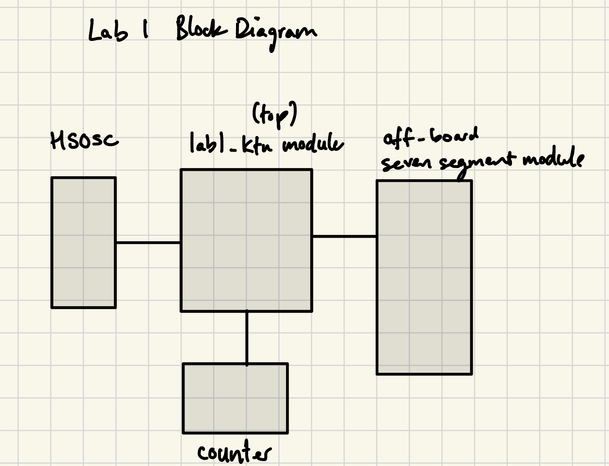
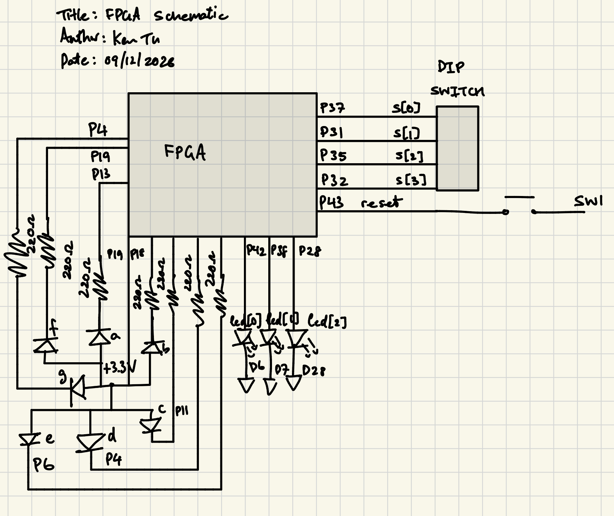
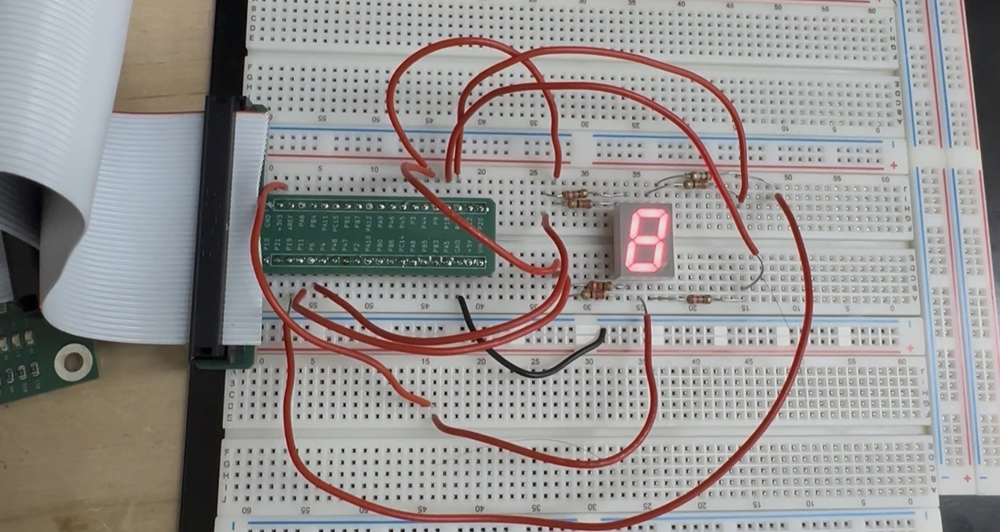
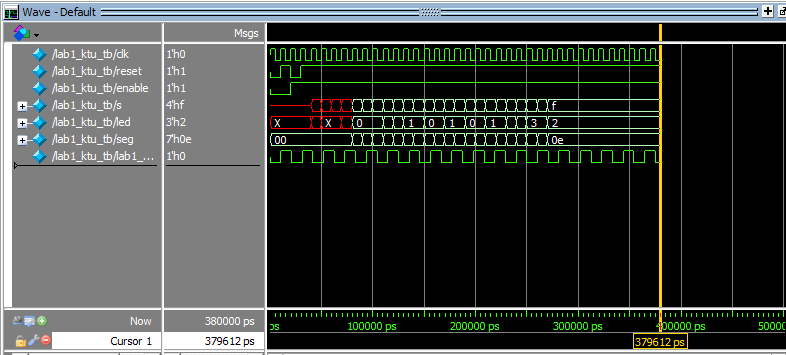
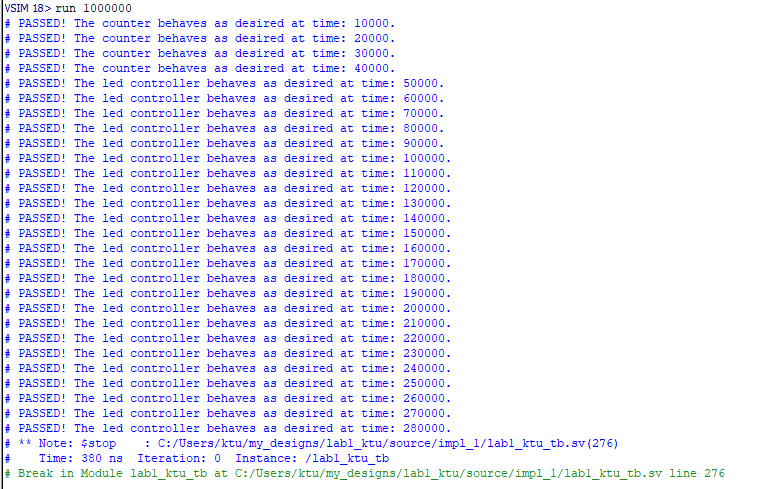
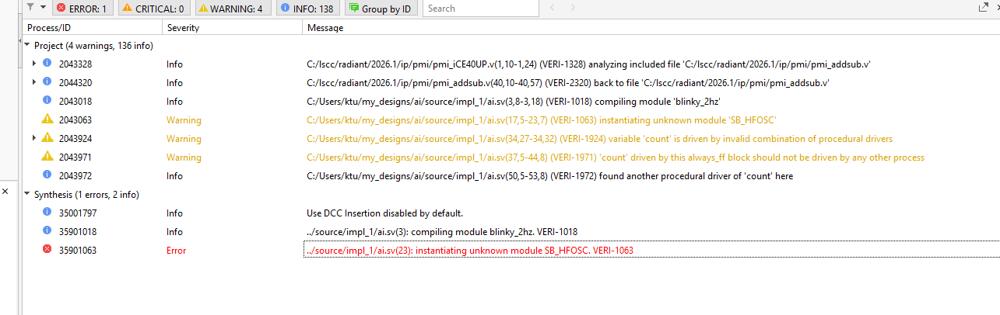
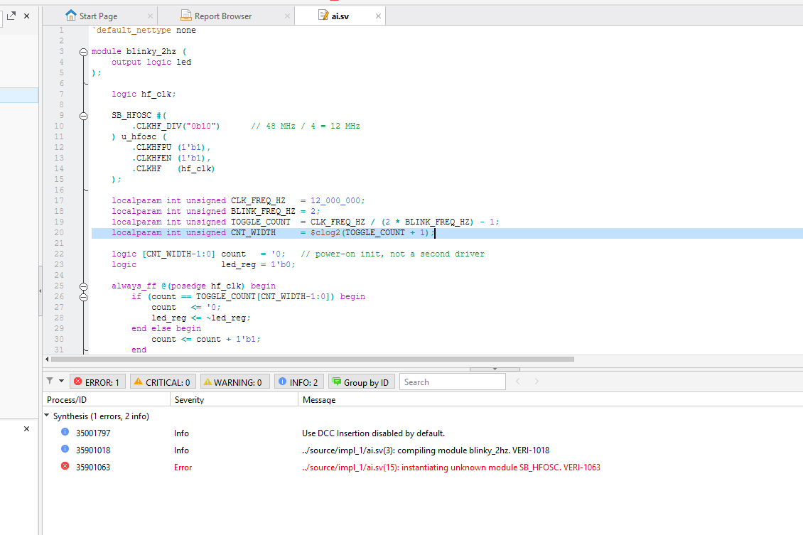

<!-- This is how you write a comment in your .qmd file -->
## Introduction

In this lab, I implement a time-multiplexing scheme to drive two seven-segment displays with a single set of FPGA I/O pins and installed a keypad and verified that the correct logical signals pass through it. The time-multiplexing scheme drives two independent alphanumeric symbols onto the two seven-segment using one on-board DIP switch and one off-board DIP switch. 

## Design and Testing Methodology

This section will explain the design of a multiplexed seven segment display and the functionality of the keypad scanner. 

The multiplexed 7-segment display screen has two 7 segment LED displays side by side. The effect is the human eye sees two independent alphanumeric representations (i.e., numbers or letters). However, what actually happens is that the same alphanumeric symbol is output to both LEDs, but only one of the LEDs is lit at a time. The design is as follows. Two switches `[3:0] switchLeft` and `[3:0] switchRight` the nibbles which decide which LEDs should be lit on on the seven-segment display such that its corresponding hexadecimal representation is output. The `switchLeft` and `switchRight` are chosen as datapaths from a mux using the signal `leftHex` to decide whether you want to output to both seven-segments the `leftSwitch`'s hexadecimal or the `rightSwitch`'s hexademical value and fed into Lab 1's `sevenseg.sv` module to output the pattern of LED required. Next, a wire drives the left seven-segment display on and another wire drives the right seven-segment display. These wires are given logic such than when one is on the other is off therefore resulting in onto one of the LEDs being lit at once. Then a counter with reset, enable, and a max count functionality is used to set the frequency at which mux chooses the left or right hexadecimal value. The counter is fed an internal clock from the FPGA's HSOSC IP block and once this counter reachs a specified max count, the 

The keypad scanner 

The DIP switch was used to drive an XOR and AND function to light two other LEDs by assigning two sets of to different bits which were encoding in the DIP switch. A testbench with the 4 different outcomes for each output was created.

As for the seven segment LED, it has seven individual LEDs which each need to be driven by a +3.3V common anode -- produced by the FPGA -- and connected to a pin on the FPGA. Similarly a testbench with all 16 single digit hexadecimal representation outputs was run. 

I use the industry standard Radiant Software to set up my SystemVerilog files to write the hardware for the FPGA and complete pin assignment to the 3 on-board LEDs and off-board seven segment LEDs. Once the files synthesized, a .bin file was created in my project folder directory. 

Next I used the openFPGA to upload my program to the FPGA. In my local terminal, I input the  commandline `openFPGALoader -b ice40_generic -c ft232  -f </path/to/bin_filename.bin>` to program my FPGA. For this project, I also had to short my UPduino and +5V in located on J3 of the PCB in order to provide power to the board.

## Technical Documentation

The source code for the project can be found in the associated [Github repository](https://github.com/KenDTu/E155-Portfolio).


::: {.callout-note collapse="true"}
## Figure 1: Lab 1 Block Diagram

:::

<!-- ::: {.callout-note collapse="true"}
## Figure X: Image title

{#fig-blockdiagram}

::: -->

<!-- ::: {.callout-note collapse="true"}
## Figure X: Image title

```systemverilog
module top(
    input  logic clk,
    output logic [3:0] led
);
endmodule
```

::: -->
The block diagram in Figure 1 demonstrates the overall architecture of the design. The top-level module top includes three submodules: the high-speed oscillator block (HSOSC), the counter module (which acts as a clock divider), and the seven segment module. 

The code for each module can be shown from the drop down menus below where we instantiated the HSOSC, counter, and seven segment modules wiht the lab1-ktu top module.


## Schematic

::: {.callout-note collapse="true"}
## Figure 2: Lab 1 Schematic

:::


Figure 2 shows the physical layout of the design. An internal 100 kΩ pullup resistor was used to ensure the active low reset pin was not floating for the LEDs. The each output LED connecting to the seven segment was connected using a 220 Ω current-limiting resistor to ensure the output current  

$$I = \frac{3.3V}{220Ω} = 15mA $$
 
did not exceed the maximum output current of the FPGA I/O RBG pins which is 24mA.

## Results and Discussion

The design most of the intended design objectives. Figure 3 shows a screenshot of the seven segment LED showing an 8 when the bit representation 00001000 is triggered on the DIP switch.


::: {.callout-note collapse="true"}
## Figure 3: Seven segment LED

:::

If a more precise output frequency was desired, a more sophisticated counter could be developed. The current frequency of oscillation is actually closer to 2.8Hz rather than the 2.4Hz desired. The current design only allows for the clock to be divided by powers of two. Testing the reset button on the hardware also demonstrates that it functions as the LED does not blink when my assigned reset switch is pressed.

### Testbench Simulation

The design met the specifications for the seven segment, the counter, and the on-board LED logic.


::: {.callout-note collapse="true"}
## Figure 4: QuestSim Simulation

:::

::: {.callout-note collapse="true"}
## Figure 5: Testbench

:::


A few shortcomings of this project are not including the test cases for the counter reaching its max value and verification of internal signals for the top module. Other excellent specifications could be met such as verifying the reset, enable, and other top module behaviour such as the HSOSC and the connections. These I did not have enough time to work on given the many logisitical challenges I had with this project. 

## Conclusion

The design successfully produces SystemVerilog files and project synthesis to verify logic controls to two LEDs, a blinking LED with a clock divider, and a seven segment LED to represent the hexadecimal representation of 8 bit signal from a DIP switch. In total I spent 65 hours on this lab in one week.

## AI Prototype Summary

For this lab, students were tasked to see if “can my LLMs of choice generate SystemVerilog that compiles, synthesizes and exhibits correct behavior?" We were told to prompt our favorite LLM

"Write SystemVerilog HDL to leverage the internal high speed oscillator in the Lattice UP5K FPGA and blink an LED at 2 Hz. Take full advantage of SystemVerilog syntax, for example, using logic instead of wire and reg."

Figures 6 and 7 demonstrate the output when the SystemVerilog code was synthesized. 

::: {.callout-note collapse="true"}
## Figure 6: LLM's first file compilation attempt

:::

::: {.callout-note collapse="true"}
## Figure 7: Recomplation for correction

:::


From the code generation, I conclude that the output is not the most accurate. There are newly constructed syntax such as this `localparan int unsigned` which I have never come across before. During the first synthesis, the errors were that the code generated was trying to use a module that did not exist the first time around or was not include. In the next iteration, the module was able to be instantiated. 

With these results, I would not trust Claude LLM to generate me code but perhaps would use it to spot errors in my code or file hierachy.
