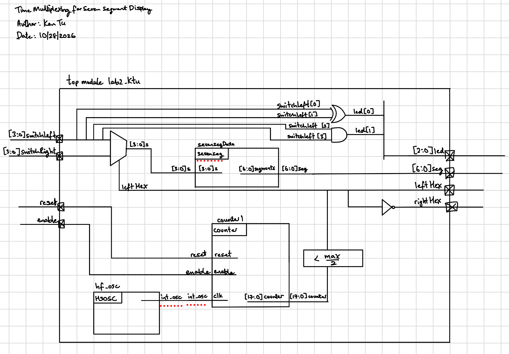
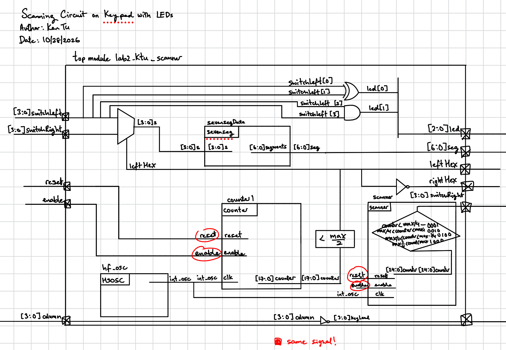
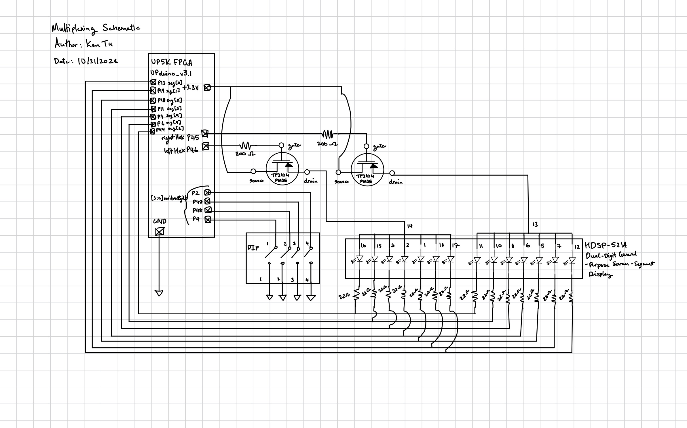
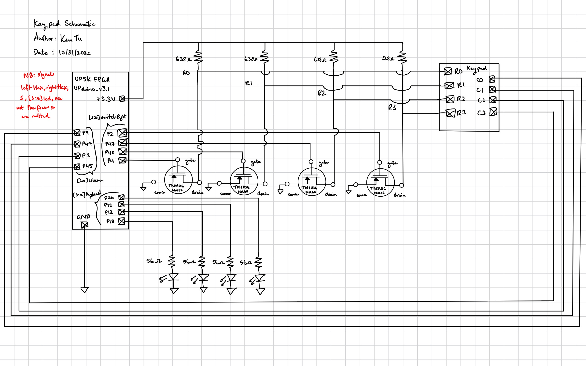
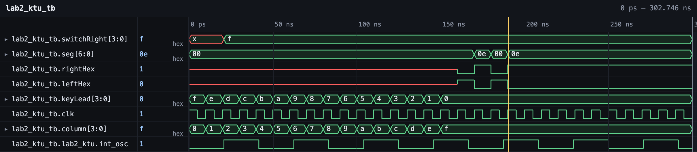
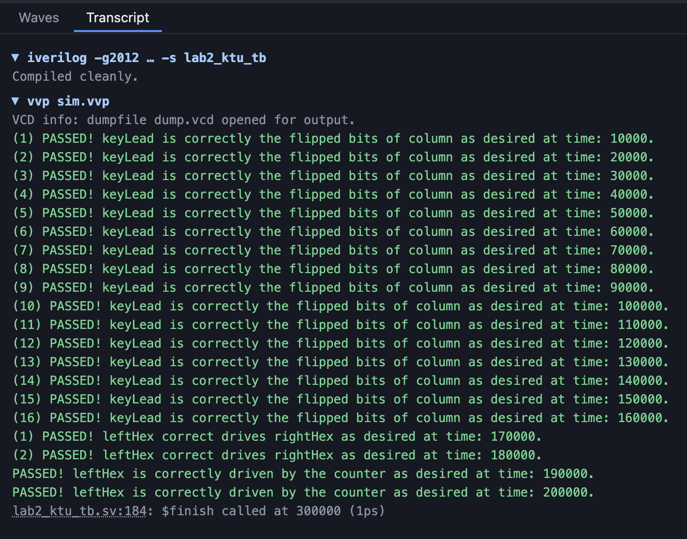
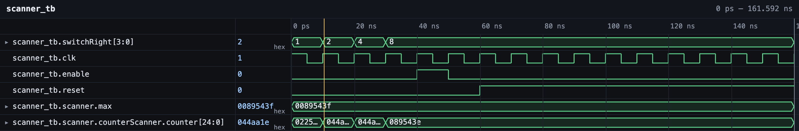
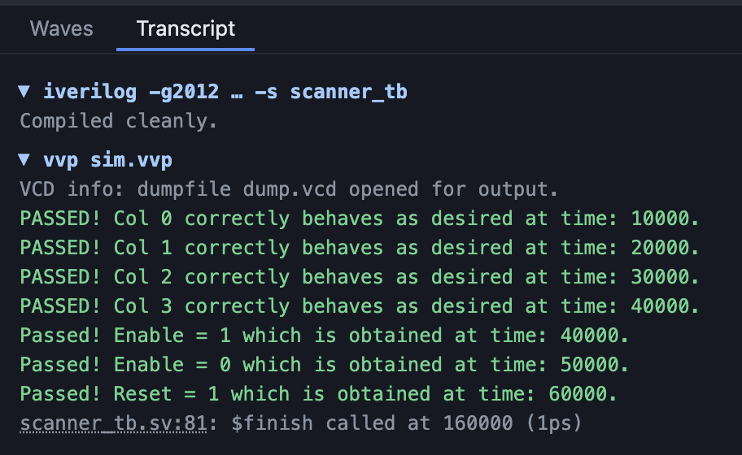

<!-- This is how you write a comment in your .qmd file -->
## Introduction

In this lab, I implement a time-multiplexing scheme to drive two seven-segment displays with a single set of FPGA I/O pins and installed a keypad and verified that the correct logical signals pass through it. The time-multiplexing scheme drives two independent alphanumeric symbols onto the two seven-segment using one on-board DIP switch and one off-board DIP switch. 

## Design and Testing Methodology

This section will explain the design of a multiplexed seven segment display and the functionality of the keypad scanner. 

The multiplexed 7-segment display screen has two 7 segment LED displays side by side. The effect is the human eye sees two independent alphanumeric representations (i.e., numbers or letters). However, what actually happens is that the same alphanumeric symbol is output to both LEDs, but only one of the LEDs is lit at a time. The design is as follows. Two switches `[3:0] switchLeft` and `[3:0] switchRight` the nibbles which decide which LEDs should be lit on on the seven-segment display such that its corresponding hexadecimal representation is output. The `switchLeft` and `switchRight` are chosen as datapaths from a mux using the signal `leftHex` to decide whether you want to output to both seven-segments the `leftSwitch`'s hexadecimal or the `rightSwitch`'s hexademical value and fed into Lab 1's `sevenseg.sv` module to output the pattern of LED required. Next, a wire drives the left seven-segment display on and another wire drives the right seven-segment display. These wires are given logic such than when one is on the other is off therefore resulting in onto one of the LEDs being lit at once. Then a counter with reset, enable, and a max count functionality is used to set the frequency at which mux chooses the left or right hexadecimal value. The counter is fed an internal clock from the FPGA's HSOSC IP block and once this counter reaches a specified max count, the counter is reset. 

The keypad scanner asserts a signal for each row of the keyboard using a counter from its scanner module. A `scanner` module was implemented with an instantiated scanner to count up to a maximum value. Then as the `counter` value ticks up to a `max` value the rows are asserts of a quarter of the cycle time of the counter each. This was done using `counter < max/4`, `max/4 < counter && counter < max/2`, `max/2 < counter && counter < 3*max/4`, `3*max/4 < counter && counter < max` logic where a specified row was asserted. TN2106 NMOS transistor was used to turn off and on the signal going into each row of the keypad. Then the column signals where fed as input into the FPGA. And these column signals where negated to provide an output signal to the LED in the form of `[3:0] keyLead`. 

I used the openFPGA to upload my program to the FPGA. In my local terminal, I input the  commandline `openFPGALoader -b ice40_generic -c ft232  -f </path/to/bin_filename.bin>` to program my FPGA. For this project, I also had to short my UPduino and +5V in located on J3 of the PCB in order to provide power to the board.

## Technical Documentation

The source code for the project can be found in the associated [Github repository](https://github.com/KenDTu/E155-Portfolio). Below you can see my multiplexing and keyboard section block diagrams.

::: {.callout-note collapse="true"}
## Figure 1: Multiplexing section block diagram for the synthesis of the top module

:::

::: {.callout-note collapse="true"}
## Figure 2: Keyboard section block diagram for the synthesis of the top module

:::

<!-- ::: {.callout-note collapse="true"}
## Figure X: Image title

{#fig-blockdiagram}

::: -->

<!-- ::: {.callout-note collapse="true"}
## Figure X: Image title

```systemverilog
module top(
    input  logic clk,
    output logic [3:0] led
);
endmodule
```

::: -->
The multiplexing block diagram in Figure 1 demonstrates the overall architecture of the design. The top-level module top includes three submodules: the high-speed oscillator block (HSOSC), the counter module (which acts as a clock divider), and the seven segment module. We also include a small logic block for when the signal reaches its half its maximum value.

The keypad block diagram in Figure 2 has a top module consisting of the same modules as the multiplexing block diagram but also include a new module -- scanner which provides the assertion to the rows of the keypad. 

In the next section, each schematic for the circuits are drawn. 

## SystemVerilog Code for the Scanner and Keypad Module

Keypad module.
```{.systemverilog code-fold="true"}
// Author: Ken Tu
// Email: ktu@g.hmc.edu
// Date of Creation: 09/20/2026
// Top Module to instantiate HSOSC, counter, seven-segment, and scanner module
`timescale 1 ns/1 ps
// alter the counterWidth from 18 to 22
// alter the max from 249_999 to 5_999_999
module lab2_ktu #(parameter max = 5_999_999, parameter counterWidth = 24)
	   (input logic [3:0] switchLeft, // the four DIP switches (on the board, SW6)
		output logic [3:0] switchRight, // the off board DIP switch
		input logic [3:0] column, // columns into FPGA
		input logic reset, // switch for reset on the board
		input logic enable, // switch for enable on the board
		output logic [2:0] led,   // 3 LEDs (you may use the on-board LEDs)
		output logic [6:0] seg,   // the segments of a common-anode 7-segment display
		output leftHex, // to toggle the left seven segment power
		output rightHex, // to toggle the right seven segment power
		output [3:0] keyLead  // to toggle the LEDs
);
  logic [3:0] s;
	logic int_osc;
	logic [counterWidth:0] counter;

	// Internal high-speed oscillator
	HSOSC #(.CLKHF_DIV(2'b01))
		hf_osc (.CLKHFPU(1'b1), .CLKHFEN(1'b1), .CLKHF(int_osc));
	
	// Instantiating Counter to oscillate the l
	counter counter1(.clk(int_osc), .reset(reset), .enable(enable), .counter(counter));
	sevenseg sevensegData(.s(s), .segments(seg));
	
	// assign leftHex = (counter > max/2);
	assign leftHex = (counter < max/2);
	assign rightHex = ~leftHex; // if rightHex is on then leftHex should be off
	
	assign s = leftHex ? switchLeft : switchRight;
	
	// switchRight[3] - P4, switchRight[2] - P48, switchRight[1] - P47, switchRight[0] - P2
	
	// pin assignments from lab 1 to verify
    //  Assign LED output
	assign led[0] = switchLeft[1] ^ switchLeft[0];
	assign led[1] = switchLeft[3] && switchLeft[2];
	assign led[2] = (counter < max/2);
	
	// SCANNER
	scanner scanner(.clk(int_osc), .reset(reset), .enable(enable), .switchRight(switchRight));
	assign keyLead = ~column;
	
endmodule
```


Scanner module. 
``` {.systemverilog code-fold="true"}
// Author: Ken TU 
// Email: ktu@g.hmc.edu
// Date of Creation: 09/22/2026
// Scanner module for the scanning section for lab 2
`timescale 1 ns/1 ps
module scanner #(parameter counterWidth = 25, parameter max = 8_999_999)
			  (input  logic       clk, // when instantiating pass int_osc
			   input  logic       reset,
			   input  logic       enable,
			   // input  logic [3:0] column, // when instantiating pass off-board switchRight
			   output logic [3:0] switchRight   // drives the 4 NPN gates and performs the row scanning AKA row
			   // output logic [3:0] keyLead // off-board LED shows the pressed column
);
	logic [counterWidth-1:0] counter; // this logic must toggle at 2Hz

	counter #(.counterWidth(counterWidth), .max(max)) counterScanner(.clk(clk), .reset(reset), .enable(enable), .counter(counter));
	
	always_ff @(posedge clk) // , negedge reset
		begin
			// if (counter == 999_999) rowNum <= rowNum + 1; // 
			if (counter < max/4) 
				switchRight = 4'b0001; // R0
			else if (max/4 < counter && counter < max/2) 
				switchRight = 4'b0010; // R1
			else if (max/2 < counter && counter < 3*max/4) 
				switchRight = 4'b0100; // R1
			else if (3*max/4 < counter && counter < max) 
				switchRight = 4'b1000; // R2
			else 
				switchRight = 4'b1111;
		end
		
endmodule
```

## Schematic

::: {.callout-note collapse="true"}
## Figure 3: Multiplexing Schematic

:::

::: {.callout-note collapse="true"}
## Figure 4: Keypad Schematic

:::

Figures 3 and 4 show the multiplexing and keypad schematics respectively. Current-limited resistors were also used to prevent the yellow LED lights from blowing up. 

## Results and Discussion

The design achieved all of its intended design purposes. The row assertion of the LED through the keypad are working and the multiplexing are functional. 

### Testbench Simulation

The design met the specifications for the keypad and the multiplexing functionality. The keypad's enable and reset functionality are also working. 

::: {.callout-note collapse="true"}
## Figure 5: Keypad and multiplexing seven-segment and keypad top module simulation square waves

:::

::: {.callout-note collapse="true"}
## Figure 6: Keypad and multiplexing seven-segment top module simulation messages

:::

::: {.callout-note collapse="true"}
## Figure 7: Keypad and multiplexing seven-segment top module simulation messages

:::

::: {.callout-note collapse="true"}
## Figure 8: Scanner module simulation messages

:::

## Conclusion

The design successfully produces SystemVerilog files and project synthesis to multiplex a dual seven-segment display and a scanner module to interrogate rows on a keypad. In total I spent 70 hours on this lab.

## AI Prototype Summary

For this lab, students were tasked to ask AI to “Write SystemVerilog HDL to time multiplex a single seven segment decoder (that decodes from four bits to a common anode seven segment display) to decode two sets of input bits and drive two sets of seven output bits." We were told to prompt our favorite LLM and I used Claude.ai. 

Claude generated the following piece of code.

```{.systemverilog code-fold="true"}
// -----------------------------------------------------------------------------
// seg7_decoder
// Combinational 4-bit hex -> 7-segment decoder for a COMMON ANODE display.
// Segments are active-low (0 = lit).  seg = {g,f,e,d,c,b,a}
// -----------------------------------------------------------------------------
module seg7_decoder (
    input  logic [3:0] bin,
    output logic [6:0] seg      // {g,f,e,d,c,b,a}, active low
);
    always_comb begin
        unique case (bin)
            4'h0:    seg = 7'b100_0000;
            4'h1:    seg = 7'b111_1001;
            4'h2:    seg = 7'b010_0100;
            4'h3:    seg = 7'b011_0000;
            4'h4:    seg = 7'b001_1001;
            4'h5:    seg = 7'b001_0010;
            4'h6:    seg = 7'b000_0010;
            4'h7:    seg = 7'b111_1000;
            4'h8:    seg = 7'b000_0000;
            4'h9:    seg = 7'b001_0000;
            4'hA:    seg = 7'b000_1000;
            4'hB:    seg = 7'b000_0011;
            4'hC:    seg = 7'b100_0110;
            4'hD:    seg = 7'b010_0001;
            4'hE:    seg = 7'b000_0110;
            4'hF:    seg = 7'b000_1110;
            default: seg = 7'b111_1111;  // all off
        endcase
    end
endmodule
```

```{.systemverilog code-fold="true"}
// -----------------------------------------------------------------------------
// seg7_tdm
// Shares ONE seg7_decoder between two 4-bit inputs.
//
// A 1-bit phase counter toggles every clock.  It selects which input nibble is
// fed to the decoder, and the decoder result is captured into the output
// register belonging to that input.  Each output register therefore updates
// every 2 clocks and holds its value in between, so seg_a and seg_b are both
// stable, continuously valid 7-bit outputs.
//
// Latency: a change on in_a/in_b appears on seg_a/seg_b within 2 clocks.
// -----------------------------------------------------------------------------
module seg7_tdm (
    input  logic       clk,
    input  logic       rst_n,    // active-low async reset
    input  logic [3:0] in_a,
    input  logic [3:0] in_b,
    output logic [6:0] seg_a,    // common anode, active low
    output logic [6:0] seg_b
);
    logic       phase;           // 0 -> channel A, 1 -> channel B
    logic [3:0] mux_out;
    logic [6:0] dec_out;
 
    // Time-multiplex the input to the single decoder
    assign mux_out = phase ? in_b : in_a;
 
    // The one shared decoder
    seg7_decoder u_dec (
        .bin (mux_out),
        .seg (dec_out)
    );
 
    // Phase counter and output capture registers
    always_ff @(posedge clk or negedge rst_n) begin
        if (!rst_n) begin
            phase <= 1'b0;
            seg_a <= 7'b111_1111;   // blank
            seg_b <= 7'b111_1111;
        end else begin
            phase <= ~phase;
            if (!phase) seg_a <= dec_out;
            else        seg_b <= dec_out;
        end
    end
endmodule
```

From the code generated and comparing with own code, the seg7_decoder is correct and generated pretty much 1-1 accuracy with my own code using an `always_comb`, however, what is unique is the use of the `unique case` rather than just the `case` keyword which I have never seen before. Researching the difference in meaning online I find that "case on its own implements sequential priority logic, whereas unique case tells your tools that the branches are completely independent and parallel." I think `unique case` is true for our use case but `case` is also sufficient. I don't think it makes a difference in logic when outputing the desired seven-segment display. The main difference is the implementation of the multiplexing. The AI version does not make use of a counter module. 

With these results, I would trust Claude to help tackles more trivial, simple and fatiguing tasks which are unique.
