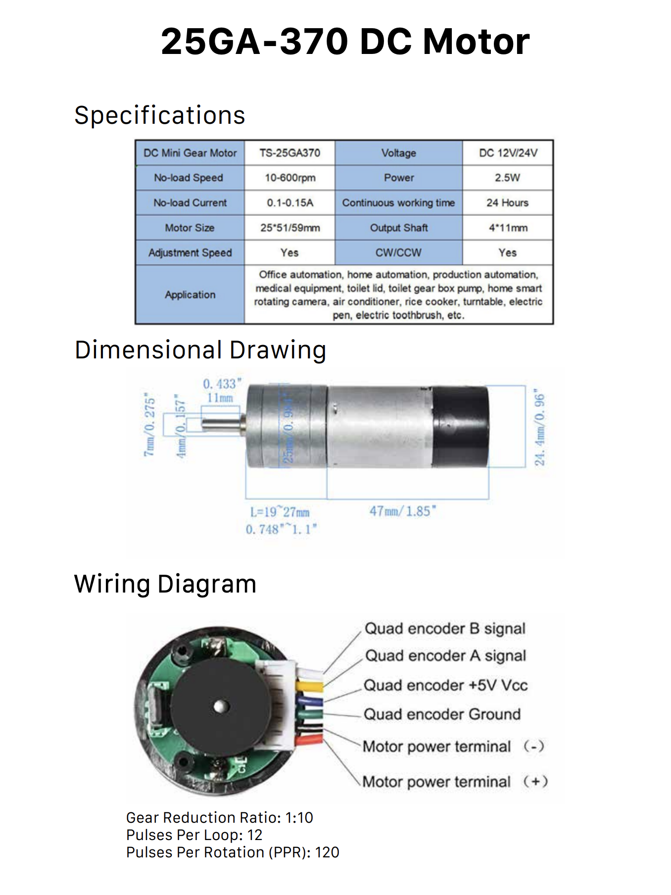
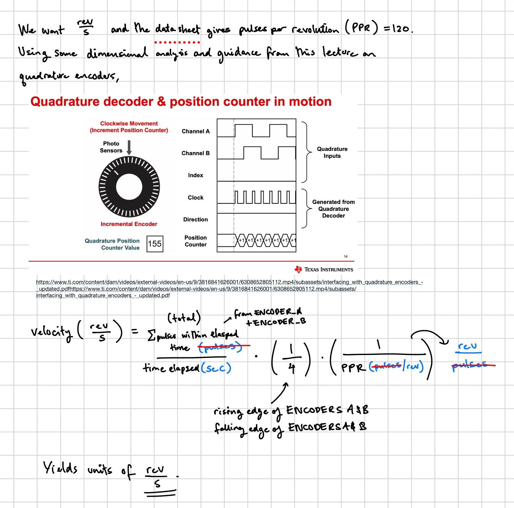
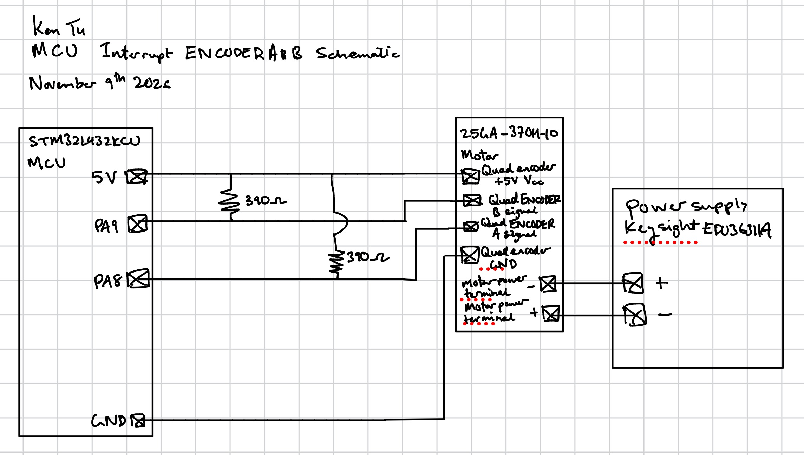
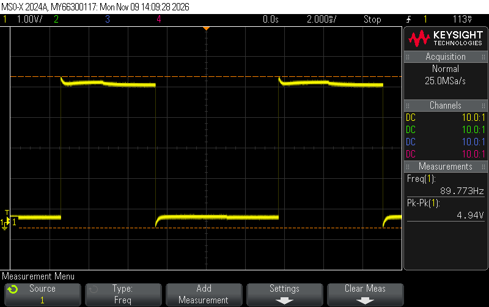
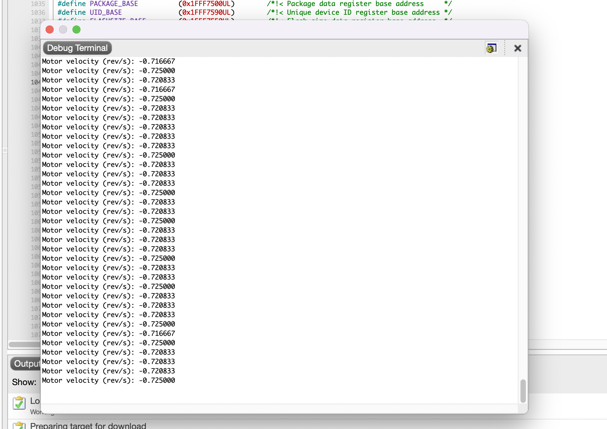

<!-- This is how you write a comment in your .qmd file -->
## Introduction

In this lab, I used my MCU to determine the velocity of a motor in (rev/s) by reading from a quadrature encoder using interrupts. An interrupts is a hardware or software signal that temporarily halts the processor's current execution flow so it can immediately handle a high-priority event or requests. In our case, the MCU executes an interrupt service routine each time the either `ENCODER_A` or `ENCODER_B` has a rising or falling edge. All quadrature encoders contain two stationary digital sensors, and a disc that rotates with the motor. The encoders used in this lab use hall effect sensors and magnets to detect the motor rotation. I used the 25GA-370 DC Motor to spin a flag and observe the velocity in revolutions per second (rev/s)

::: {.callout-note collapse="true"}
## Figure 1: Motor Datasheet

:::

## Design and Testing Methodology

I chose pins `PA8` and `PA9` to be my GPIO input to cause the interrupt activated them correspondingly by configuring their mask bit on the External Interrupt Mask Register 1, and enables their Rising Trigger Selection Register 1, and Falling Trigger Selection Register 1, globally enabling the interrupts, enabled their interrupt request (IRQ) on the Nested Vectored Interrupt Controller (NVIC), explicitly declared interrupt priorities, and used some logic and math to compute the motor velocity. Derivation of the motor velocity are computed below.

::: {.callout-note collapse="true"}
## Figure 2: Motor velocity (rev/s) calculation

:::

Within the velocity calculation line, we use delayed of 2Hz or 500ms to meet the specification of updating the velocity to at least a rate of 1Hz. Hence we satisfy the criterion there. We divide by a factor of four because each rising and falling edge of `ENCODER_A` and `ENCODER_B` provide an additional count to divide. 

The clock-wise and counter-clockwise rotation are 
[explanation here of how the CW and CCW rotations are calculated]

## Technical Documentation

The source code for the project can be found in the associated [Github repository](https://github.com/KenDTu/E155-Portfolio).

Below is my code for the `main.c` which uses `printf` function to print motor velocity to the debug terminal.

::: {.callout-tip collapse="true"}
## Click to expand main.c
```{{c}}
// main.c
// Ken Tu
// ktu@g.hmc.edu
// 11/06/2026

#include "main.h"
#include "STM32L432KC_TIM16.h"

// Define macros

#define ENCODER_A PA8 // Encoders from the motor -- 15 to 10
#define ENCODER_B PA9  //                         -- 5 to 9
#define PPR 120       // Pulses per revolution from the 25GA-370 DC Motor
#define CPR 4         // Count per revolution

// State machine for direction of motion for motor
volatile uint32_t stateA = 0;
volatile uint32_t stateB = 0;

volatile uint32_t newA = 0;
volatile uint32_t newB = 0;

// Used to verify that the PC passes through the IRQ handler
volatile uint32_t countA = 0;
volatile uint32_t countB = 0;

// Used to indicate CW or CCW with default CW = 1
volatile int direction = 1;

// With an interrupt to measure 1 second of time for the pulse/s the s value
volatile int totalCount = 0;

// Used to show the line number on the terminal
volatile int count = 0;

// Used velocity for motor
volatile float velocity = 0;

// Used to calculate number of peaks on quad encoder
volatile float positionCount = 0;

volatile int32_t timer = 500;

// Function used by printf to send characters to the laptop
int _write(int file, char *ptr, int len) {
  int i = 0;
  for (i = 0; i < len; i++) {
    ITM_SendChar((*ptr++));
  }
  return len;
}

void configureSystemClocks(void) {
    // Configures the system clock for the TIMERs
    configureFlash();
    // configureClock();
    // select 4HMz as the clock for TIM2

    // 1. Enable SYSCFG clock domain in RCC
    // RCC->APB1ENR1 |= (1 << 0); // SYSCFGEN
    // RCC->APB1ENR1 |= (1 << 0); // TIM2EN
    RCC->APB1ENR1 |= RCC_APB1ENR1_TIM2EN; // TIM2

}
void setupInterrupt(void) {
    gpioEnable(GPIO_PORT_A);
    pinMode(ENCODER_A, GPIO_INPUT);

    // Enable PA8 as input
    pinMode(ENCODER_B, GPIO_INPUT);

    SYSCFG->EXTICR[2] &= ~(SYSCFG_EXTICR3_EXTI8);

    // Configure interrupt for falling and rising edge of GPIO pin for ENCODER_A
    EXTI->IMR1 |= (1 << gpioPinOffset(ENCODER_A));   // 1. Configure mask bit
    EXTI->RTSR1 |= (1 << gpioPinOffset(ENCODER_A));  // 2. Enable rising edge trigger
    EXTI->FTSR1 |= (1 << gpioPinOffset(ENCODER_A));  // 3. Enable falling edge trigger

    // Configure interrupt for falling and rising edge of GPIO pin for ENCODER_B
    EXTI->IMR1 |= (1 << gpioPinOffset(ENCODER_B));   // 1. Configure mask bit
    EXTI->RTSR1 |= (1 << gpioPinOffset(ENCODER_B));  // 2. Enable rising edge trigger
    EXTI->FTSR1 |= (1 << gpioPinOffset(ENCODER_B));  // 3. Enable falling edge trigger

    // Enable interrupts globally
    __enable_irq();

    __NVIC_EnableIRQ(EXTI9_5_IRQn);         // Turn on EXTI interrupt for lineEXTI lines 5 to 9.
    // __NVIC_EnableIRQ(TIM1_UP_TIM16_IRQn); // 

    // Setting priorities manually.
    __NVIC_SetPriority(EXTI9_5_IRQn, 1);
    // __NVIC_SetPriority(TIM1_UP_TIM16_IRQn, 2);

}

void setupTimer(void) {
    // ============== TIMER SETUP ===================
    initTIM(TIM2); // TIM2
    RCC->APB1ENR1 |= RCC_APB1ENR1_TIM2EN; // TIM2

}

int main(void) {

    configureSystemClocks();
    setupInterrupt();
    setupTimer();

    delay_millis(TIM2, 100);

    while(1){

        delay_millis(TIM2, timer); // 2Hz delay or 500ms
        float d = positionCount;
        positionCount = 0;
        velocity = (float)(d * (1000/timer)) / (4 * PPR);
        printf("Motor velocity (rev/s): %f \n", velocity);

    }
}

void EXTI9_5_IRQHandler(void) {

    // Finding the direction clockwise or counter-clockwise for the motor
    newA = digitalRead(ENCODER_A);
    newB = digitalRead(ENCODER_B); 
  
    if (EXTI->PR1 & (1 << gpioPinOffset(ENCODER_A))) {   // PA9 → line 9
        EXTI->PR1 = (1 << gpioPinOffset(ENCODER_A));
        if (newA == 1 && newB == 1) {
          direction = -1;
        } else if (newA == 0 && newB == 0) {
          direction = -1;
        } else if (newA == 1 && newB == 0) {
          direction = 1;
        } else if (newA == 0 && newB == 1) {
          direction = 1;
        } 
        countA++;
        positionCount+=direction;
    }

    if (EXTI->PR1 & (1 << gpioPinOffset(ENCODER_B))) {   // PA8 → line 8
        EXTI->PR1 = (1 << gpioPinOffset(ENCODER_B));
        if (newA == 1 && newB == 1) {
          direction = 1;
        } else if (newA == 0 && newB == 0) {
          direction = 1;
        } else if (newA == 1 && newB == 0) {
          direction = -1;
        } else if (newA == 0 && newB == 1) {
          direction = -1;
        }
        countB++;
        positionCount+=direction;
    }

    count++;
}

```
:::

Below is a schematic diagram of my motor setup. 
::: {.callout-note collapse="true"}
## Figure 3: Analog ENCODER_A signal frequency

:::

## Results 

My results demonstrates that I was successfully able to read the velocity of the 25GA-370 DC Motor for clock-wise and counter clock-wise rotations. The code also correctly reads 0 rev/s when the motor is not spinning. 

Students were also tasked with comparing the results of the interrupt with their calculated motor velocity. To do this I connected an oscilloscope to one of the encoder pins and calculated the rev/s based on the frequency. I kept the voltage at 1.0V and current at 0.5A on the motor terminal. When analyzing the rev/s on the oscilloscope and comparing it with the value obtained on the debug terminal we can see the following.

::: {.callout-note collapse="true"}
## Figure 4: Analog ENCODER_A signal frequency

:::
::: {.callout-note collapse="true"}
## Figure 5: Motor velocity

:::

Using the oscilloscope, I saw that the frequency of the encoder was 89.773Hz. The motor velocity according to this is 

$\text{velocity (rev/s) = frequency / PPR} = 89.773 \text{Hz} / 120 = 0.74810833 \text{rev/s}$

As my calculation approximately of the velocity give a magnitude 0.725 rev/s, this is incredibly close to the actual signal analog signal so I was fairly accurate. 

## Conclusion

I was able to successfully achieve the goals for this lab by creating a quadrature decoder for a motor and display the motor's velocity in rev/s and accounting for its spinning direction.

## AI Prototype Summary

For this lab, students were tasked to see if AI can “Write me interrupt handlers to interface with a quadrature encoder. I’m using the STM32L432KC, what pins should I connect the encoder to in order to allow it to easily trigger the interrupts?" We were told to prompt our favorite LLM. Claude gave me the code below and also added some instructional remarks.

::: {.callout-note collapse="true"}
## Figure 6: Claude AI made motor controller
```{{c}}
#include "stm32l4xx_hal.h"

#define ENC_PORT   GPIOA
#define ENC_A_PIN  GPIO_PIN_0
#define ENC_B_PIN  GPIO_PIN_1

static volatile int32_t enc_count = 0;
static volatile uint8_t enc_prev  = 0;

/* Index = (prev_state << 2) | curr_state, where state = (A << 1) | B.
 * Valid Gray-code steps give +1/-1; no change or an invalid jump
 * (e.g. contact bounce skipping a state) gives 0. */
static const int8_t enc_table[16] = {
     0, +1, -1,  0,
    -1,  0,  0, +1,
    +1,  0,  0, -1,
     0, -1, +1,  0
};

static inline uint8_t enc_read_state(void)
{
    uint32_t idr = ENC_PORT->IDR;
    return (uint8_t)((((idr & ENC_A_PIN) ? 1U : 0U) << 1) |
                      ((idr & ENC_B_PIN) ? 1U : 0U));
}

static inline void enc_update(void)
{
    uint8_t curr = enc_read_state();
    enc_count += enc_table[(enc_prev << 2) | curr];
    enc_prev = curr;
}

void Encoder_Init(void)
{
    __HAL_RCC_GPIOA_CLK_ENABLE();

    GPIO_InitTypeDef gpio = {0};
    gpio.Pin  = ENC_A_PIN | ENC_B_PIN;
    gpio.Mode = GPIO_MODE_IT_RISING_FALLING;   /* interrupt on both edges */
    gpio.Pull = GPIO_PULLUP;                   /* for open-collector/mechanical encoders */
    HAL_GPIO_Init(ENC_PORT, &gpio);            /* also enables SYSCFG clock */

    enc_prev = enc_read_state();               /* seed the state machine */

    HAL_NVIC_SetPriority(EXTI0_IRQn, 1, 0);
    HAL_NVIC_EnableIRQ(EXTI0_IRQn);
    HAL_NVIC_SetPriority(EXTI1_IRQn, 1, 0);
    HAL_NVIC_EnableIRQ(EXTI1_IRQn);
}

/* Interrupt handlers (names must match the startup file vector table) */
void EXTI0_IRQHandler(void)
{
    __HAL_GPIO_EXTI_CLEAR_IT(ENC_A_PIN);
    enc_update();
}

void EXTI1_IRQHandler(void)
{
    __HAL_GPIO_EXTI_CLEAR_IT(ENC_B_PIN);
    enc_update();
}

int32_t Encoder_GetCount(void)
{
    return enc_count;   /* aligned 32-bit reads are atomic on Cortex-M4 */
}
```
:::

The code won't work because there is not pin `PA0` and `PA1` on my adapter, however, Claude did not know that but it does make strong use of the correct CMSIS files and sets IRQ servicing very clearly. 
<!-- ::: {.callout-note collapse="true"}
## Figure X: Image title

{#fig-blockdiagram}

::: -->

<!-- ::: {.callout-note collapse="true"}
## Figure X: Image title

```systemverilog
module top(
    input  logic clk,
    output logic [3:0] led
);
endmodule
```

::: -->
